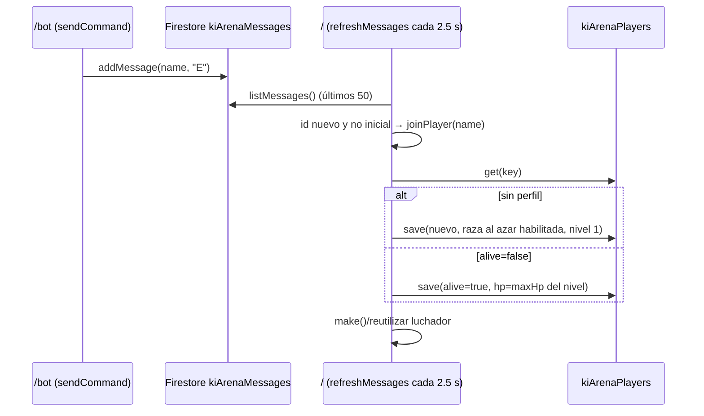

# Diseño — Entrada de jugadores

## Flujo

En `/` también existe `postChat` (si la vista tiene el panel de chat): registra la `E`, marca su ID en `seenMessages` y llama a `joinPlayer` directamente.

## Piezas

| Función | Archivo | Responsabilidad |
|---|---|---|
| `normalizeUsername` | `game/arena.js` | `trim().toLowerCase()` |
| `joinPlayer(raw)` | `game/arena.js` | Validación, anti-duplicado (`joiningUsers`, luchador vivo), creación/reingreso, persistencia |
| `make(...)` | `game/arena.js` | Construye el luchador desde el registro: stats por nivel, HP proporcional, color de raza |
| `init()` | `game/arena.js` | Crea luchadores para perfiles vivos al arrancar |
| `sendCommand` | `app/bot-app.js` | Valida nombre y publica el mensaje; no crea perfiles |

## Datos

Ver `persistencia-firestore`. Campos escritos al crear: `id` (= `usernameKey`), `reference` (ruta completa `…/environments/{APP_ENV}/kiArenaPlayers/{usernameKey}`), `isActive true`, `username`, `usernameKey`, `race` (0–3), `level`, `xp`, `kills`, `deaths`, `alive`, `hp`, `maxHp`, `hpFormulaVersion`, `schemaVersion 2`, `updatedAt`.

## Decisiones

- La creación del perfil vive en la arena (consumidor), no en `/bot` (productor), para que una sola pieza decida raza y estado inicial.
- La raza no depende del nombre: un usuario llamado «Freezer3» puede ser Saiyajin.
