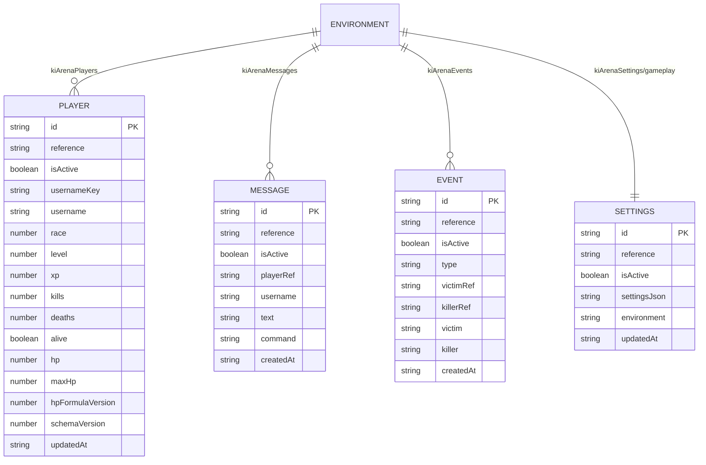

# Diseño — Persistencia Firestore

> **Rutas Firestore (obligatorio):** todo modelo de este módulo vive en `environments/{APP_ENV}/{colección}/{id}`: colección raíz `environments`, un documento por entorno (`dev`, `qa`, `prd`) y dentro todas las colecciones. Cualquier ruta abreviada en este archivo (`kiArenaX/{id}`) cuelga de ese prefijo. Ver `.kiro/steering/reglas-datos.md`.

## Adaptador `services/firebase/arena-cloud.js`

`createArenaCloud(cfg)` devuelve `{ get, save, listPlayers, getSettings, saveSettings, addMessage, addEvent, listMessages, listEvents, health, setStatus }` y se expone como `window.kiArenaCloud` desde `main.js`.

- Base: `https://firestore.googleapis.com/v1/projects/{projectId}/databases/(default)/documents`.
- Autenticación: solo `?key=<apiKey web>`; sin usuario. El control real son las reglas (hoy públicas).
- `toFields`: string→`stringValue`, boolean→`booleanValue`, number→`doubleValue`, null→`nullValue`. `fromFields` lee `stringValue ?? integerValue ?? doubleValue ?? booleanValue`.
- `save` usa `PATCH` (upsert completo de los campos listados), sin transacción ni precondición.
- `listPlayers` pagina de 1000 en 1000 con `nextPageToken`.
- `listEvents` traga errores y devuelve `[]`.

## Campos base y borrado suave (regla obligatoria)

Todo documento declara `id` (= ID del doc), `reference`, `isActive` como **opcionales**: las escrituras nuevas los llenan y las lecturas toleran su ausencia (`id` ← ID del doc, `isActive` ausente = activo). Además `createdAt`/`updatedAt`. `reference` es la referencia Firestore completa del propio documento (`referenceValue`, incluye `environments/{APP_ENV}`); las relaciones se guardan igual (`playerRef`, `victimRef`, `killerRef`). Ver `reglas-datos.md`.

API objetivo del adaptador (tras las tareas 2.x):

| Función | Cambio |
|---|---|
| `save`, `addRecord`, `saveSettings` | Añadir `id`, `reference`, `isActive` (true al crear; conservar el existente al actualizar). Usar `updateMask` para no pisar `isActive`. |
| `get`, `getSettings` | Devolver `null` si `isActive === false`; completar `id` con el ID del documento si falta. |
| `listPlayers`, `listMessages`, `listEvents` | Filtrar `isActive !== false` en cliente (un filtro de servidor `isActive == true` excluiría los documentos sin el campo). |
| `toFields` / `fromFields` | Soportar `referenceValue` para escribir y leer referencias completas; rechazar referencias de otro entorno. |
| `softDelete(kind, id)` **nuevo** | `PATCH isActive=false, updatedAt`. Único modo de «borrar». |
| — | Nunca `DELETE`. |

## Entorno `APP_ENV`

Módulo propuesto `config/environment.js`: lee `APP_ENV` (inyectado al desplegar, p. ej. `window.__KI_ARENA_ENV__` desde un `env.js` generado por destino de Hosting), valida `dev|qa|prd` y exporta `paths = { players, messages, events, settings }` construidos como `environments/{APP_ENV}/…`. `firebase.js` y `arena-cloud.js` consumen solo ese módulo.

## Configuración `config/firebase.js` (estado actual)

`createFirebaseConfig(search)` → objeto congelado con `apiKey, authDomain, projectId 'sayayin-c0dfe', appId, databaseId '(default)', environment, environmentPath 'environments/{env}/kiArena', collectionPath 'environments/{env}/kiArenaPlayers'`.

## Modelo

Referencia ampliada: `KiArena/docs/FIRESTORE.md`.

## Riesgos

- Sin transacciones: dos pestañas pueden pisarse el progreso.
- Reglas públicas: cualquiera puede escribir perfiles.
- Hoy no hay `DELETE` en el código; las escrituras actuales aún no llenan `id`/`reference`/`isActive` (son opcionales, así que los documentos existentes siguen siendo válidos).
- Fechas generadas por el cliente (`new Date().toISOString()`), no por el servidor.
