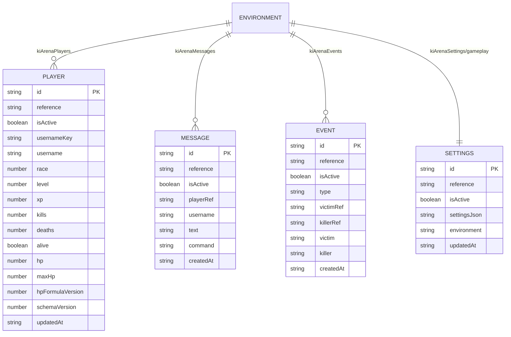

# Diseño — Persistencia Firestore

> **Rutas Firestore (obligatorio):** todo modelo de este módulo vive en `environments/{APP_ENV}/{colección}/{id}`: colección raíz `environments`, un documento por entorno (`dev`, `qa`, `prd`) y dentro todas las colecciones. Cualquier ruta abreviada en este archivo (`kiArenaX/{id}`) cuelga de ese prefijo. Ver `.kiro/steering/reglas-datos.md`.

## Adaptador `services/firebase/arena-cloud.js`

`createArenaCloud(cfg)` devuelve `{ get, save, listPlayers, getSettings, saveSettings, addMessage, addEvent, listMessages, listEvents, health, setStatus }` y se expone como `window.kiArenaCloud` desde `main.js`.

- Base: `https://firestore.googleapis.com/v1/projects/{projectId}/databases/(default)/documents`.
- Autenticación: solo `?key=<apiKey web>`; sin usuario. El control real son las reglas (hoy públicas).
- `toFields`: string→`stringValue`, boolean→`booleanValue`, number→`doubleValue`, null→`nullValue`. `fromFields` lee `stringValue ?? integerValue ?? doubleValue ?? booleanValue`.
- `save` usa `PATCH` (upsert completo de los campos listados), sin transacción ni precondición.
- `listPlayers` pagina de 1000 en 1000 con `nextPageToken`.
- `listEvents` traga errores y devuelve `[]`.

## Campos base y borrado suave (regla obligatoria)

Todo documento declara `id` (= ID del doc), `reference`, `isActive` como **opcionales**: las escrituras nuevas los llenan y las lecturas toleran su ausencia (`id` ← ID del doc, `isActive` ausente = activo). Además `createdAt`/`updatedAt`. `reference` es la referencia Firestore completa del propio documento (`referenceValue`, incluye `environments/{APP_ENV}`); las relaciones se guardan igual (`playerRef`, `victimRef`, `killerRef`). Ver `reglas-datos.md`.

API objetivo del adaptador (tras las tareas 2.x):

| Función | Cambio |
|---|---|
| `save`, `addRecord`, `saveSettings` | Añadir `id`, `reference`, `isActive` (true al crear; conservar el existente al actualizar). Usar `updateMask` para no pisar `isActive`. |
| `get`, `getSettings` | Devolver `null` si `isActive === false`; completar `id` con el ID del documento si falta. |
| `listPlayers`, `listMessages`, `listEvents` | Filtrar `isActive !== false` en cliente (un filtro de servidor `isActive == true` excluiría los documentos sin el campo). |
| `toFields` / `fromFields` | Soportar `referenceValue` para escribir y leer referencias completas; rechazar referencias de otro entorno. |
| `softDelete(kind, id)` **nuevo** | `PATCH isActive=false, updatedAt`. Único modo de «borrar». |
| — | Nunca `DELETE`. |

## Entorno `APP_ENV`

Módulo propuesto `config/environment.js`: lee `APP_ENV` (inyectado al desplegar, p. ej. `window.__KI_ARENA_ENV__` desde un `env.js` generado por destino de Hosting), valida `dev|qa|prd` y exporta `paths = { players, messages, events, settings }` construidos como `environments/{APP_ENV}/…`. `firebase.js` y `arena-cloud.js` consumen solo ese módulo.

## Configuración `config/firebase.js` (estado actual)

`createFirebaseConfig(search)` → objeto congelado con `apiKey, authDomain, projectId 'sayayin-c0dfe', appId, databaseId '(default)', environment, environmentPath 'environments/{env}/kiArena', collectionPath 'environments/{env}/kiArenaPlayers'`.

## Modelo

Referencia ampliada: `KiArena/docs/FIRESTORE.md`.

## Propuesta: tipos de personaje y jugadores (Pedro, 2026-10-24) · PENDIENTE

Mismo patrón que el login (`kiArenaProviderTypes` → `kiArenaProviders`): un catálogo de tipos de personaje y los jugadores apuntando a él con una referencia completa. Reemplaza el número `race` y la lista fija `CHARACTER_OPTIONS`.

### `environments/{APP_ENV}/kiArenaPlayerTypes/{code}` — catálogo

| Campo | Tipo | Obligatorio | Descripción |
|---|---|---|---|
| `id` | string | Opcional | = `code` (`goku`, `piccolo`, `gohan`, `freezer`) |
| `reference` | referencia | Opcional | Referencia completa a sí mismo |
| `isActive` | boolean | Opcional | `false` = retirado (borrado suave); ausente = activo |
| `code` | string | Sí | Llave estable del tipo |
| `name` | string | Sí | Personaje: Goku, Piccolo, Gohan, Freezer |
| `raceRef` | referencia | Sí | → `kiArenaRaces/{code}` (Saiyajin, Namekuseijin, Terrícola, Freezer) |
| `legacyRace` | number | Opcional | Número `race` antiguo (0–3) para leer jugadores viejos |
| `color` | string | Opcional | Color del aura/roster (`#ff9d3d`…) |
| `isEligible` | boolean | Opcional | Si sale al crear un jugador nuevo (hoy `settings.characters`) |
| `order` | number | Opcional | Orden en settings y roster |
| `createdAt` / `updatedAt` | string ISO | Opcional | Fechas |

Datos iniciales:

| `code` | `name` | `raceRef` | `legacyRace` | `color` |
|---|---|---|---|---|
| `goku` | Goku | `…/kiArenaRaces/saiyajin` | 0 | `#ff9d3d` |
| `piccolo` | Piccolo | `…/kiArenaRaces/namekuseijin` | 1 | `#68e47b` |
| `gohan` | Gohan | `…/kiArenaRaces/terricola` | 2 | `#68b9ff` |
| `freezer` | Freezer | `…/kiArenaRaces/freezer` | 3 | `#c487ff` |

### `environments/{APP_ENV}/kiArenaRaces/{code}` — razas (Pedro, 2026-10-24)

Cada raza define sus características y una **utilidad** propia. Todo es editable por entorno desde settings. Los valores de `stats` son multiplicadores sobre la fórmula base de `calculateLevelStats` (1.0 = sin cambio); la vida (`hp`) sigue siendo global.

| Campo | Tipo | Obligatorio | Descripción |
|---|---|---|---|
| `id`, `reference`, `isActive` | string / ref / bool | Opcional | Campos base |
| `code` | string | Sí | `saiyajin`, `namekuseijin`, `terricola`, `freezer` |
| `name` | string | Sí | Nombre visible |
| `stats.ki` | number | Sí | Multiplicador de ki (poder de los ataques de ki) |
| `stats.physicalAttack` | number | Sí | Multiplicador de daño físico |
| `stats.physicalDefense` | number | Sí | Multiplicador de defensa física |
| `stats.kiDefense` | number | Sí | Multiplicador de defensa de ki |
| `utility.code` | string | Sí | Llave de la utilidad (`zenkai`, `regeneracion`, `ingenio`, `transformacion`) |
| `utility.name` / `utility.description` | string | Sí | Texto visible |
| `utility.params` | map | Sí | Variables de la utilidad, editables (ver abajo) |
| `color`, `order` | string / number | Opcional | Aura y orden |
| `createdAt` / `updatedAt` | string ISO | Opcional | Fechas |

Valores iniciales (propuesta, ajustables):

| Raza | `ki` | `physicalAttack` | `physicalDefense` | `kiDefense` | Perfil |
|---|---|---|---|---|---|
| Saiyajin | 1.10 | 1.20 | 0.95 | 0.90 | Agresivo, crece al perder |
| Namekuseijin | 1.05 | 0.95 | 1.10 | 1.10 | Resistente, se cura |
| Terrícola | 0.95 | 1.00 | 1.00 | 1.00 | Equilibrado, sube más rápido |
| Freezer | 1.25 | 0.95 | 0.95 | 1.05 | Ki alto, remonta al final |

Utilidades:

| Raza | Utilidad | Qué hace | `utility.params` (por defecto) |
|---|---|---|---|
| Saiyajin | **Zenkai** | Cada derrota le da un bono permanente a todas sus stats, con tope | `bonusPerDefeat: 0.03`, `maxBonus: 0.15` |
| Namekuseijin | **Regeneración** | Fuera de combate recupera un % de su vida máxima por segundo | `regenPerSecond: 0.02`, `outOfCombatSeconds: 3` |
| Terrícola | **Ingenio** | Gana más experiencia y puede esquivar golpes | `xpBonus: 0.20`, `dodgeChance: 0.08` |
| Freezer | **Transformación** | Con poca vida se transforma: más daño por unos segundos, una vez por vida | `hpThreshold: 0.30`, `damageBonus: 0.25`, `durationSeconds: 8` |

El estado de la utilidad que cambia con el juego (p. ej. el Zenkai acumulado) se guarda en el jugador: `kiArenaPlayers.utilityState` (map, opcional; Saiyajin: `{ zenkaiBonus }`).

### `environments/{APP_ENV}/kiArenaPlayers/{id}` — jugador (tabla intermedia usuario × tipo de personaje)

Relación muchos a muchos: un usuario tiene varios personajes y un tipo lo tienen muchos usuarios. `id` = `{userId}:{code}` para jugadores con cuenta; los de chat sin cuenta conservan `usernameKey`. El nombre (`name`/`nameKey`) y el progreso viven aquí. `kiArenaUsers` gana `playerRefs[]` y `primaryPlayerRef` (reemplaza `playerRef`). Diagrama: `ki-arena/modelo-personajes/modelo-personajes.html` en los archivos del proyecto.

| Campo | Tipo | Obligatorio | Descripción |
|---|---|---|---|
| `id` | string | Opcional | `usernameKey` (con Twitch/TikTok: `{plataforma}_{idExterno}`) |
| `reference` | referencia | Opcional | Referencia completa a sí mismo |
| `isActive` | boolean | Opcional | Borrado suave; ausente = activo |
| `playerTypeRef` | referencia | Opcional* | → `kiArenaPlayerTypes/{code}`. *Obligatorio en escrituras nuevas |
| `userRef` | referencia | Opcional | → `kiArenaUsers/{uid}` (HU-AUT-09) |
| `race` | number | Opcional | Legado; solo se lee si falta `playerTypeRef` (se mapea por `legacyRace`) |
| `username`, `usernameKey` | string | Sí | Nombre visible y normalizado |
| `level`, `xp`, `kills`, `deaths` | number | Sí | Progreso |
| `alive`, `hp`, `maxHp`, `hpFormulaVersion` | boolean / number | Sí | Estado en arena (no es `isActive`) |
| `utilityState` | map | Opcional | Estado acumulado de la utilidad de su raza |
| `schemaVersion` | number | Sí | Sube a `3` con `playerTypeRef` |
| `createdAt` / `updatedAt` | string ISO | Opcional / Sí | Fechas |

### Relaciones

| Desde | Campo | Hacia | Cardinalidad |
|---|---|---|---|
| `kiArenaPlayerTypes` | `raceRef` | `kiArenaRaces` | N tipos → 1 raza |
| `kiArenaPlayers` | `playerTypeRef` | `kiArenaPlayerTypes` | N jugadores → 1 tipo |
| `kiArenaPlayers` | `userRef` | `kiArenaUsers` | N jugadores → 1 usuario (por definir) |
| `kiArenaUsers` | `playerRef` | `kiArenaPlayers` | jugador principal |
| `kiArenaMessages` | `playerRef` | `kiArenaPlayers` | — |
| `kiArenaEvents` | `victimRef`, `killerRef` | `kiArenaPlayers` | — |

Compatibilidad: un jugador sin `playerTypeRef` se lee por `race` → tipo con ese `legacyRace`; al volver a guardarlo se completa `playerTypeRef` sin borrar `race`.

## Riesgos

- Sin transacciones: dos pestañas pueden pisarse el progreso.
- Reglas públicas: cualquiera puede escribir perfiles.
- Hoy no hay `DELETE` en el código; las escrituras actuales aún no llenan `id`/`reference`/`isActive` (son opcionales, así que los documentos existentes siguen siendo válidos).
- Fechas generadas por el cliente (`new Date().toISOString()`), no por el servidor.
